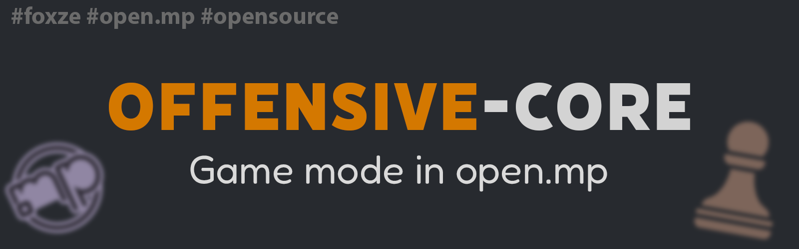

Offensive-Core - это большой проект сочетающий в себе многофункциональный игровой режим (gamemode) и сопутствующие 
к нему файлы написанные на языке Pawn для серверов SA-MP и [open.mp](https://open.mp/).
На основе реализованных методов можно создавать абсолютно любимые режимы и подрежимы для них.
Код можно с лёгкостью модернизировать и расширять для своих нужд. В проекте представлены режимы: TDM, DM и Room.

Проект не является какой-либо модификацией других игровых режимов. 
Написан и продуман полностью с нуля.

## 📌 Основные системы
- Режимы: TDM, DM, Room
- Инвентарь
- Торговая площадка
- Квесты
- Премиум аккаунт
- Промокоды
- Функционал для админов
- Помощник Дина

Скриншоты из игры на сервере можно посмотреть [здесь](https://github.com/NikitaFoxze/Offensive-Core/tree/main/media/Server).

# ⚽ Режим TDM
В этом режиме сражаются игроки в команде. В зависимости от игрового режима (подрежима) игрокам нужно захватывать точки, флаги, взламывать компьютеры и т.д.
Для спавна игрок может выбрать другого игрока из своего отряда, либо на точке или базе.

Для игрока открыто 4 класса: штурмовик, медик, инженер и разведчик. Каждый класс прокачивается индивидуально.
Оружие, патроны, способности и т.д. приобретаются за внутреннюю валюту. Максимальное количество команд - 4.

# ⚾ Режим Room
Режим Room немного схож с режимом TDM. Это кастомный режим в котором игрок создаёт свою сессию со своими параметрами. Для игры в него нужно минимум 2 игрока, максимум - 10.

В этом режиме также сражаются игроки в команде. В зависимости от игрового режима (подрежима) игрокам нужно захватывать точки, взламывать компьютеры и т.д.
Для спавна игрок может выбрать только базу. Классов - нет. Игрок может выбирать в параметрах сессии время, локацию, оружие, режим и т.д.

# 🔨 Логика работы всех режимов
Режимы находятся в своих папках и имеют свои системы. Они как отдельные "миры".
В корне почти каждого режима есть папка "locations". В ней находится файл с различным функционалом для манипуляций 
с локациями. Сами локации также размещены в своих папках.

При запуске сервера происходит инициализация всех режимов и их стартовых сессий.
Когда происходит смена локации в режиме, то все созданнные компоненты (пикапы, объекты и т.д.) на локации удаляются 
и создаются новые для новой локации.

Такой метод создания и удаления локаций имеет много плюсов. 
Режимы можно делить на несколько сессий, поэтому нужно думать про лимиты SA-MP, 
а конкретнее про лимиты на создание транспорта, остальные компоненты 
по типу пикапов создаются динамическими.

Режимы можно активировать и деактивировать, а также управлять сессиями в них.

Все режимы объединяет файл "modes_main.pwn" в папке "modes".

# 📑 Архитектура
Архитектура проекта была сведена к максимальному упрощению и удобству в использовании.
Как говорилось выше, каждый режим имеет свою папку, как и остальные системы.
Все системы подключаются в файле "offensive-core.pwn".
Системы сервера находятся в папке "sources". Внешние файлы в папке "library".

Само распределение систем по файлам было логичным, т.к. хранить десятки тысяч строк кода в одном файле было уже 
довольно тяжело для редактирования чего-либо.

## 📄 Файлы
> name_head.inc - содержит основные макросы, функции, ...

> name_td.inc - содержит все TextDraw's системы.

> name_main.pwn - содержит весь функционал системы.

# 🚀 Мощный режим TDM
Изюминкой всего перечисленного является режим TDM. 
Для каждой локации в нём можно создавать различные индивидуальные моменты и ситуации, например, 
на локации "Пустыня" можно сбросить ядерную бомбу на противоположную команду. 

Чтобы это сделать, нужно захватить "Точку связи", дальше взорвать дверь, которая рядом и запустить спутник. 
Далее получить коды доступа командой /accode и попасть на подлодку и там уже запустить ядерную ракету, которая полетит на базу противника. 

При существующих системах конкретно для TDM режима, это уже легко реализуемо прямо в файле для локации "Пустыня". 
При этом всём, легко манипулировать различными компонентами через код, 
а созданные эти самые компоненты будут автоматически удалены при смене локации и снова возобновлены! 
Это работает в различных сессиях и они не связаны друг с другом.

# 📖 Wiki
Намного больше информации можно узнать в разделе [Wiki](https://github.com/NikitaFoxze/Offensive-Core/wiki)

# 🔧 Зависимости
Проект использует несколько популярных плагинов и файлов последних версий для улучшенной работы с кодом и их возможностями.

Плагины:
- [sscanf v2.13.8](https://github.com/Y-Less/sscanf)
- [streamer v2.9.6](https://github.com/samp-incognito/samp-streamer-plugin)
- [MySQL vR41-4](https://github.com/pBlueG/SA-MP-MySQL)
- [Pawn.CMD v3.4.0-omp](https://github.com/katursis/Pawn.CMD)
- [Pawn.RakNet v1.6.0-omp](https://github.com/katursis/Pawn.RakNet)
- [Pawn.Regex v1.2.3-omp](https://github.com/katursis/Pawn.Regex)
- [rustext v2.0.10](https://github.com/ziggi/rustext)
- [CrashDetect v4.22](https://github.com/Y-Less/samp-plugin-crashdetect)
- [Bcrypt v2.2.3](https://github.com/lassir/bcrypt-samp)

Файлы:
- [weapon-config](https://github.com/oscar-broman/samp-weapon-config)
- [nex-ac v1.9.66](https://github.com/NexiusTailer/Nex-AC)
- [foreach v2.2.7](https://github.com/Open-GTO/foreach)
- [mdialog v1.4.3](https://github.com/Open-GTO/mdialog)
- [cinterface v1.0.0](https://github.com/NikitaFoxze/cinterface)
- [StreamerFunctions](https://github.com/AbyssMorgan/SAMP/blob/main/Libs/StreamerFunction/StreamerFunction.inc)
- [progress2](https://github.com/Southclaws/progress2)

# ♥️ Благодарности
- **NexiusTailer** - огромная помощь по различным темам
- **Neutralneu (Neuty)** - реализация системы для ботов (нет в open.mp версии)
- **Roberto_Coluccio, Artem_Gorden, Danil_Marciface, VanilaSW, Dima_Rendi, Fix_Unvardo, Itsuki_Yorimoto, Flatt_Delx,
Fredorico_Viton, Demetrio_Santini, Maks_Anurov, Kocmoc, Vladislav_Barsov, Doni_Visage, DELIVER, Richi_Klay, Sebastian_Undeground** - помощь в тестировании
